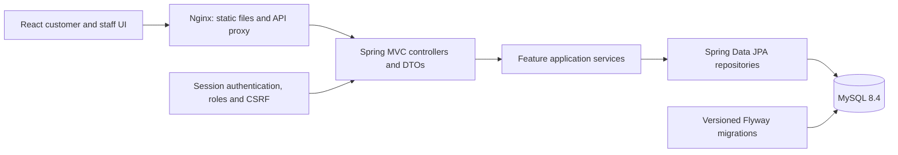

# Architecture

## Modules

Packages under `com.example.dvdrental`:

| Module | Responsibility |
|---|---|
| catalog | Titles, genres, search, catalog administration |
| identity | Registration, roles, login/session integration, development bootstrap |
| customer | Customer profiles and staff customer directory |
| inventory | Individual barcoded copies and guarded lifecycle changes |
| rental | Atomic allocation, ownership, history, staff-confirmed returns |
| pricing | Decimal rental/overdue calculations and configurable overdue rate |
| reporting | Inventory, customer, active-rental, and overdue summaries |
| common | Error handling, security, clock, bounded pagination |

Controllers translate HTTP input/output, and services own business rules and
transaction boundaries. Repositories persist entities. DTOs define public contracts;
JPA entities remain internal. Open Session in View is disabled. Flyway migrates;
Hibernate validates rather than changing the schema.

Session cookies are HTTP-only, SameSite=Lax, and secure by default. The standard
Spring Security form-login filter authenticates against database-backed users,
changes the session ID, and persists the context. CSRF protection remains active,
including login, registration, and logout. No cross-origin CORS allowances exist.
React fetches a masked CSRF token from the session endpoint before each mutation.
Authentication secrets never go into localStorage or JavaScript-accessible cookies.

Catalog reads and the CSRF endpoint are public. Customer routes require CUSTOMER,
staff operations require STAFF or ADMIN, and privileged writes require ADMIN.
Customer rental reads additionally query by the authenticated account email, returning
404 for other customers' orders. Staff and administrators use separate workflow routes.

## Compatibility decisions

Java 21 remains the baseline. Spring Boot 4.1.2 is selected instead of 3.x because
the [3.5.16 announcement](https://spring.io/blog/2026/06/25/spring-boot-3-5-16-available-now/)
directs users needing continued OSS support to 4.0/4.1.
[Boot's requirements](https://docs.spring.io/spring-boot/system-requirements.html)
include Java 21. Boot manages Spring, Hibernate, Flyway and driver versions;
[springdoc 3.2.0](https://springdoc.org/) supports Boot 4. JUnit Jupiter uses Boot's managed 6.x release: real integration verification showed
that Spring 7's test extension requires APIs absent from JUnit 5. The Jupiter test
programming model remains the same. This is a compatibility adjustment to the
specification's JUnit 5 request, alongside the supported Boot 4 baseline. Testcontainers 1.21.4
includes the Docker 29 compatibility update.

React 19 and Ant Design 6 work together without the old Ant Design 5 React 19 patch.
Vite 7 supports the Node 24 build image. The npm lockfile fixes resolved versions.
