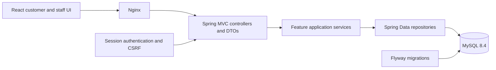

# Architecture

Packages under `com.example.dvdrental`: catalog, identity, customer, inventory,
rental, pricing, reporting, common. Only catalog and common exist at this milestone.
Controllers translate HTTP input/output. Services own business rules and transaction
boundaries. Repositories persist entities. DTOs define stable public contracts;
JPA entities remain internal. No Open Session in View or automatic schema creation.

Session cookies will be HTTP-only, SameSite=Lax, secure in production. CSRF remains
enabled. CORS has no cross-origin allowances; the eventual UI uses the same origin.
Public catalog GETs are allowed; other routes currently deny all access.
