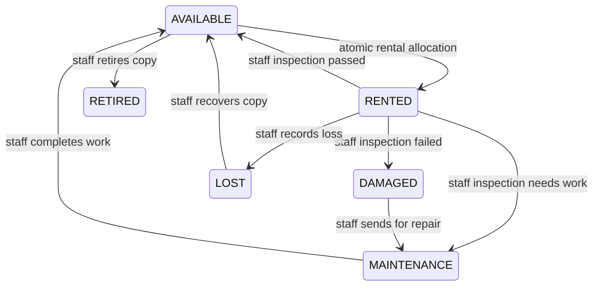

# Business rules

Only CUSTOMER accounts place rentals. A request contains 1–10 distinct copy IDs and
a rental duration of 1–30 days. The backend prices the order from current movie rates;
client prices, user IDs, roles, or dates are never trusted. All requested copies must
be available, otherwise the entire allocation rolls back.

## Inventory

Staff and administrators can move any non-rented, non-retired copy between non-RENTED states.
RETIRED is terminal. A rented copy can change only through staff return/loss processing.
A returned disc becomes AVAILABLE only when staff explicitly confirm it passed
inspection. Damaged, lost, maintenance, and retired copies cannot be allocated.
Invalid transitions and repeat returns are rejected with 409.

## Rental lifecycle and fees

An item is ACTIVE → RETURNED or LOST. Resolved items are terminal. An order is ACTIVE
while any item remains active, and CLOSED after all items are resolved. Order state
is derived from items rather than duplicated in a separate mutable column.

Base charge = daily rental rate × rental days. Currency is GBP. Rates are saved on
each item when rented. Changing movie prices or the configured overdue rate cannot
change historical rental charges or a rental's overdue daily rate.

The due date is the business calendar date at allocation plus the requested days.
The due date is inclusive. Overdue days = max(0, return date − due date). Overdue
charge = overdue days × snapshotted overdue daily rate. Monetary values use exact
two-decimal calculations. The default overdue rate is GBP 1.50/day and is configurable
through RENTAL_OVERDUE_DAILY_RATE. RENTAL_TIME_ZONE defaults to Europe/London.
Active charges are identified as estimates; return/loss confirmation fixes the final
charge and resolution instant. Lost copies do not incur a separate replacement fee.

Customers cannot backdate returns or mark DVDs available. Collection is assumed
on rental creation; there is no shipping, reservation expiry, or payment capture.
