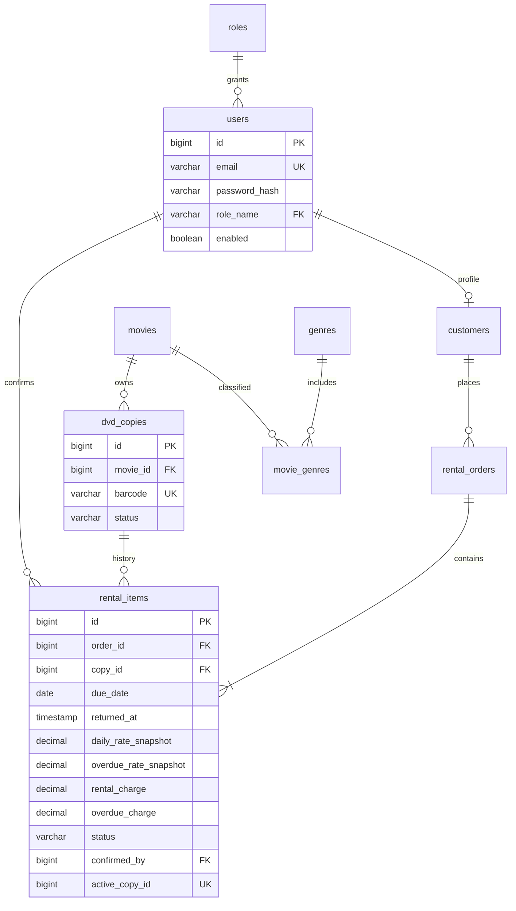

# Database model

V1 defines movies, genres, and the many-to-many join. V2 defines seeded roles,
unique accounts and customer profiles. V3 defines physical inventory. V4 defines
orders and rental items. Roles are a constrained lookup table, one role per account.
Email is normalized to lowercase in application code and uniquely constrained in MySQL.

Titles and physical copies are separate. Foreign keys retain rental history; deleting
referenced catalog records yields a conflict. Copies are retired rather than deleted.
Money uses DECIMAL and Java BigDecimal; charge columns are larger than daily rates
so a 30-day charge can safely contain the maximum allowed daily rental price.
Instants are stored in microsecond timestamp columns; due dates are calendar dates.

Indexes cover title searches, availability by movie/status, customer order history,
and active due dates. MySQL's generated `active_copy_id` is the copy ID for ACTIVE
items and NULL for resolved items. A unique index on that column permits historical
rentals while preventing two active rental items for one physical copy.

Allocation locks copy rows with SELECT FOR UPDATE in ascending ID order, checks
AVAILABLE, and creates all items in one transaction. Inventory writers use the same
locking protocol. Return confirmation first locks the order, then the relevant copy,
records the staff account, and atomically resolves both item and inventory state.

No payment gateway or offline payment ledger is implemented. Returns retain staff
attribution; a general audit-log table is not needed for the current MVP.
