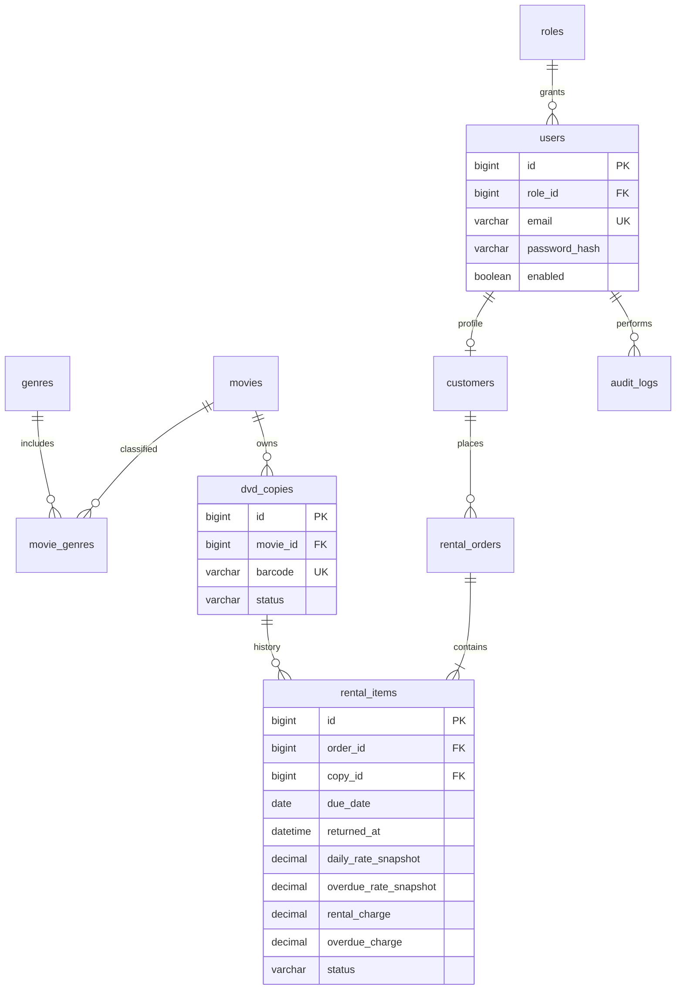

# Database model

This diagram describes the intended model. V1 implements only movies, genres, and
movie_genres; subsequent migrations add identity, inventory, and rentals.

Movie title is distinct from its physical copies. Money is DECIMAL/BigDecimal.
Foreign keys retain history. User email and barcode have unique indexes. Rental
items will index due date/status and customer orders will index customer/creation.
Allocation locks the copy row and checks AVAILABLE within the same transaction;
no application-only availability checks. All writers use the same locking protocol.
